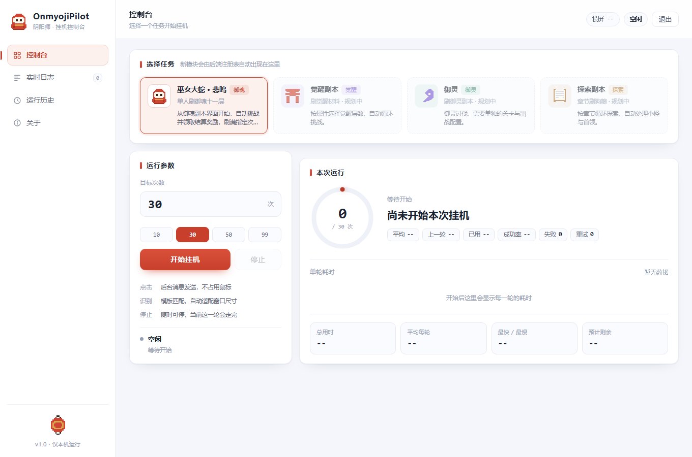

# OnmyojiPilot

**阴阳师桌面挂机 · 不开模拟器、后台点击、不抢鼠标**

通过截取手机投屏窗口的画面做模板识别，用 Windows 后台消息投递点击，
实现阴阳师副本自动挂机。全程不移动真实鼠标，你可以照常用电脑。



> ### 🙏 特别感谢 [OnmyojiAutoScript](https://github.com/nearaura/OnmyojiAutoScript)
>
> 这个项目能跑起来，靠的是 [@nearaura](https://github.com/nearaura) 的
> **[OnmyojiAutoScript](https://github.com/nearaura/OnmyojiAutoScript)**（OAS）。
>
> 识别机制、交互框架、防卡死的思路，以及全部识别模板图，都来自它。
> 本项目本质上是把 OAS 那套成熟的自动化设计，搬到一个"不开模拟器、
> 直接操作投屏窗口"的轻量场景里重新实现了一遍。
> 没有 OAS 打下的地基，这个项目不会存在。
>
> 如果你想要功能完整的阴阳师自动化（组队、御魂溢出、体力管理、更多副本），
> 请直接去用原项目：**https://github.com/nearaura/OnmyojiAutoScript**

---

## 和常见方案的区别

|  | 模拟器脚本 | **OnmyojiPilot** |
|---|---|---|
| 运行环境 | 需要装模拟器、再登录一次 | 直接用你已经登录的投屏窗口 |
| 鼠标 | 多数需要占用鼠标 | `PostMessage` 后台投递，不占用 |
| 分辨率 | 强绑定一套分辨率 | 等比映射自适应，窗口随便拖 |
| 账号 | 模拟器里的另一份 | 你手机上正在玩的那个号 |

## 已支持

| 副本 | 状态 | 说明 |
|---|---|---|
| 御魂 · 巫女大蛇（悲鸣） | ✅ 可用 | 单人，从御魂副本界面开始，刷满指定次数停止 |
| 觉醒副本 | 🚧 规划中 | 架构已就位，缺关卡识别资产 |
| 御灵 | 🚧 规划中 | 同上 |
| 探索副本 | 🚧 规划中 | 同上 |

单轮约 **27 秒**（战斗 ~20s + 结算 ~7s），实测 540×249 ~ 1600×736 各种窗口尺寸都能跑。

## 快速开始

**环境**：Windows 10/11 · Python 3.8+

```bash
git clone https://github.com/<你的用户名>/OnmyojiPilot.git
cd OnmyojiPilot
pip install -r requirements.txt
```

1. 打开 ZenLink 并连接手机，确认投屏画面正常、窗口不要最小化
2. 游戏停在 **御魂副本 · 悲鸣** 界面
3. 双击 `start_console.bat`（或 `python server.py`），浏览器会自动打开控制台
4. 选任务 → 填次数 → 开始挂机

> 探索界面那个会漂浮的灯笼没法用后台消息点中，所以**从庭院走到御魂副本这一步需要手动**。
> 停在御魂副本界面之后，全程不用管。

命令行也可以：`python main.py 30 orochi`

## 界面

- **控制台** — 选任务、设次数、实时进度环、单轮耗时柱状图、成功率
- **实时日志** — 独占整屏，支持「仅异常」过滤
- **运行历史** — 每次运行自动存档，点任意一行回看完整日志
- **关于** — 架构说明与扩展步骤

## 工作原理

```
投屏窗口 ──PrintWindow──▶ 画面
                            │
                    等比映射 fit_transform(contain)
                            │
                    模板匹配（roi_back 限定搜索区）
                            │
                    判定当前界面 → 下一动作
                            │
                PostMessage(WM_LBUTTONDOWN/UP) 后台点击
```

几个关键点：

**截图**。硬件渲染的投屏层用 `BitBlt` 截出来是黑的，只有 `PrintWindow(hwnd, hdc, PW_RENDERFULLCONTENT)` 能拿到画面。

**坐标映射**。窗口不是固定尺寸，用 contain 映射（等比缩放 + 居中黑边）把基准分辨率
`878×404` 映射到当前窗口，点击坐标只在出口换算一次。

**识别**。每个模板都有搜索区（`roi_back`）和点击区（`roi_front`）。
近黑背景的细字模板（如"点击屏幕继续"）光靠 `TM_CCOEFF_NORMED` 会在亮斑上误判，
所以加了一层二值亮部结构校验，把小窗口下的漏检和误检一起解决。

**防机械点击**：

- 点击坐标按正态分布随机落在按钮区域内，严格截断不出界
- 每次等待、按压时长都是区间内的随机值
- 空白推进时随机挑一块区域，不点固定坐标
- 结算界面只点空白处，避开所有道具图标（点中会弹物品描述卡住流程）
- 同一按钮连点 10 次 / 两个按钮各 6 次 → 判为卡死并结束
- 长时间无进展 → 超时结束

## 扩展到新副本

架构为多副本预留，新增一个模块只需要三步：

1. 在 `tasks/` 下写一个继承 `BaseTask` 的任务类，实现 `run()`
2. 准备该副本的模板图与 `TEMPLATES` 配置（含 `roi_back` / `roi_front`），以及交互区域和时长表
3. 在 `tasks/registry.py` 的 `TASKS` 里追加一条 `TaskSpec`，`available=True`

**服务端和前端一行都不用改** —— 任务卡、历史记录、日志会自动接上。
未实现的任务登记为 `available=False` 即可，界面上会显示成"规划中"的灰卡。

## 目录结构

```
OnmyojiPilot/
├── core/                    # 与具体副本无关的底层能力
│   ├── window.py            #   窗口定位、PrintWindow 截图、坐标映射、后台点击
│   ├── matcher.py           #   模板匹配内核（roi + 多尺度 + 二值结构校验）
│   ├── click.py             #   随机点击区域 / 避开指定区域的随机点击
│   ├── base_task.py         #   任务基类：定时器、防卡死、点击记录
│   ├── random_utils.py      #   正态分布取点、随机时长
│   └── logbuffer.py         #   日志环形缓冲（供网页增量拉取）
├── tasks/
│   ├── registry.py          #   任务注册表（新增副本改这里）
│   └── orochi/              #   御魂模块
│       ├── orochi_task.py
│       └── templates/       #   识别模板
├── web/index.html           # 网页控制台（无外部依赖，纯原生）
├── config.py                # 模板配置、点击区域、时长表
├── bot_runner.py            # 运行器：线程管理、状态快照、历史存档
├── server.py                # 本地 HTTP 服务（stdlib，只监听 127.0.0.1）
├── main.py                  # 命令行入口
├── tools/                   # 校准与诊断脚本
└── docs/
```

约 3100 行 Python + 一个单文件前端，没有框架依赖。

## 已知限制

- 仅 Windows（依赖 Win32 的 `PrintWindow` / `PostMessage`）
- 投屏窗口**不能被最小化**，最小化后抓不到画面（会自动尝试还原）
- 从庭院到御魂副本需要手动走一次
- 只做单人模式，不涉及组队、御魂溢出、体力不足检测

## 致谢与许可

### 主要参考：[OnmyojiAutoScript](https://github.com/nearaura/OnmyojiAutoScript)

本项目的底层设计几乎全部来自
**[nearaura/OnmyojiAutoScript](https://github.com/nearaura/OnmyojiAutoScript)**（下称 OAS）。
这不是"参考了一下"，而是把它的机制逐个读懂之后重新实现的。具体对应关系：

| 本项目 | OAS 中的来源 | 借用的是什么 |
|---|---|---|
| `core/matcher.py` | `module/atom/image.py` | `RuleImage` 的 `roi_front`/`roi_back` 双层语义、多尺度匹配、退化模板检测、匹配结果清洗 |
| `core/click.py` | `module/atom/click.py` | `RuleClick` 与 `RuleClickExclude`：rejection / complement 两种取样策略 × uniform / normal 两种分布 |
| `core/base_task.py` | `tasks/base_task.py`、`module/device/device.py` | `appear` 的每目标独立 interval 定时器、`click_record`（10 次 / 6+6 判定）、`stuck_record` |
| `core/random_utils.py` | `module/base/utils/utils.py` | `random_normal_distribution_int`、`random_rectangle_point`、`ensure_time` 的截断正态采样 |
| `tasks/orochi/orochi_task.py` | `tasks/Orochi/script_task.py`、`tasks/Component/GeneralBattle/battle_wait.py` | 副本流程编排、`C_WIN_1/2/3` 随机区域点击、结算界面的 `reward_exclude_click`（只点空白、避开道具图标） |
| `tasks/orochi/templates/*.png` | `tasks/**/assets.py` 引用的图 | **全部识别模板图**，经 `tools/import_oas_assets.py` 等比缩放导入 |
| `tools/import_oas_assets.py` | `dev_tools/assets_extract.py` | 从 `assets.py` 解析 `RuleImage` 定义并批量导入模板的思路 |

OAS 是一套功能完整的阴阳师自动化框架（组队、御魂溢出、体力管理、页面图寻路、
几十个副本），成熟度远高于本项目。如果你需要的不只是"挂个御魂"，
请直接使用原项目：**https://github.com/nearaura/OnmyojiAutoScript**

### 本项目的差异

只做了一件事：把上面这套设计搬到"不开模拟器、对一个手机投屏窗口发后台消息"的场景。
为此新增的主要是 `core/window.py` 里的 Win32 截图与注入、contain 等比坐标映射、
以及单文件网页控制台和任务注册表。

### 许可

OAS 以 **GPLv3** 发布，本项目继承了它的代码与资产，因此同样以 **GPLv3** 发布，见 [LICENSE](LICENSE)。
如果你要基于本项目做修改并分发，请一并保留 GPLv3 与上述出处说明。

> 仅供学习交流，请自行承担使用风险。请遵守游戏用户协议，不要用于商业用途。
